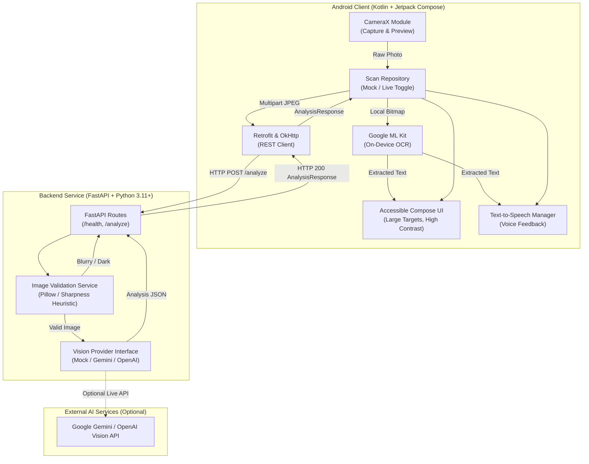
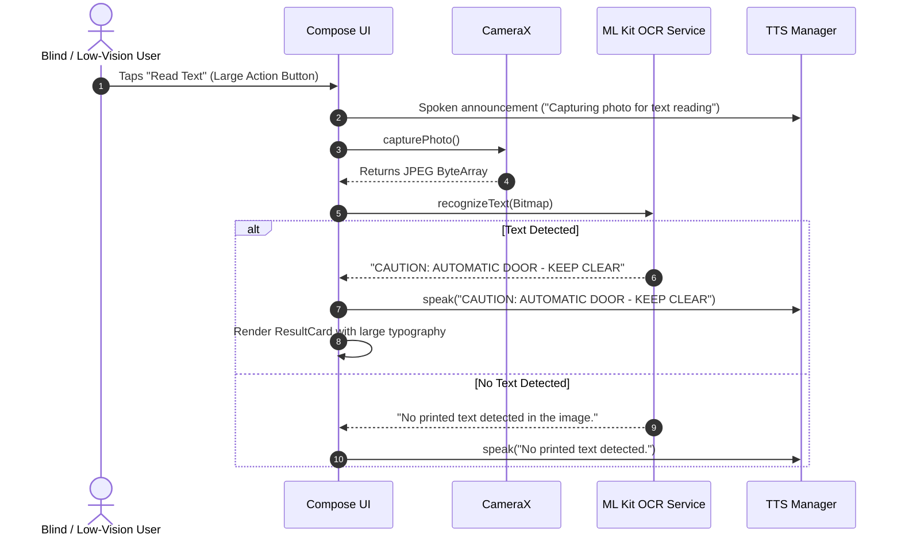
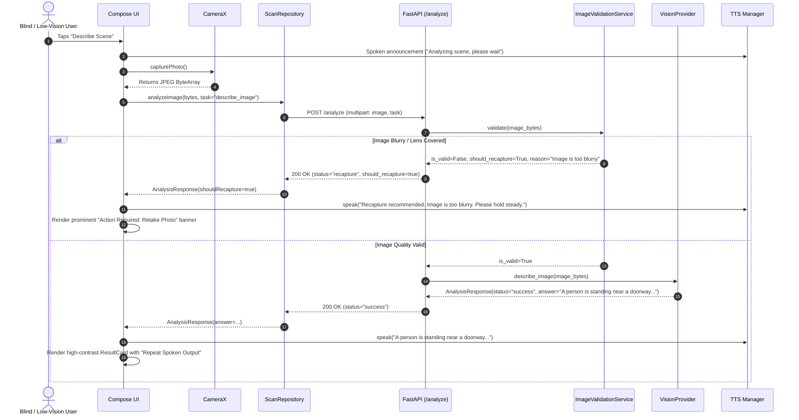

# OptiScan Architecture & System Design

OptiScan is an AI-powered visual assistant built for blind and low-vision individuals. It pairs an accessible, high-contrast Android frontend with an extensible FastAPI backend to deliver real-time visual scene descriptions, printed text reading, and instant acoustic feedback.

---

## 1. High-Level Architecture Diagram

---

## 2. Core Workflows & Sequence Diagrams

### 2.1. Workflow 1: On-Device Text Reading (ML Kit OCR)

To minimize latency and support offline operation, printed text recognition runs directly on the device using Google ML Kit.

### 2.2. Workflow 2: Surroundings Description & Scene Understanding

Scene description is dispatched to the backend service. The backend validates image quality and queries the active vision provider.

---

## 3. Modular Architecture & Extension Points

### 3.1. Vision Provider Strategy (`VisionProvider`)
The backend decouples API routing from AI inference via an abstract strategy pattern:

- **`MockVisionProvider` (Default):** Enabled out-of-the-box for local testing, CI pipelines, and demos without requiring paid API keys or cloud credentials.
- **`ExternalVisionProviderStub`:** Ready-to-implement pluggable provider for Google Gemini (`gemini-1.5-flash`), OpenAI (`gpt-4o`), or Anthropic Claude.
- **Switching Mechanism:** Driven purely by `.env` variables (`VISION_PROVIDER=gemini` and `VISION_API_KEY=...`). No route modifications required.

### 3.2. Dual-Engine Text Recognition
- **Primary:** On-device Android ML Kit Text Recognition handles OCR with low latency, privacy preservation, and zero data cost.
- **Secondary / Fallback:** Backend `/analyze` accepts `task=read_text` as a secondary fallback if on-device model files are missing or cloud confirmation is needed.

### 3.3. Offline Mock Backend Mode
The Android `ScanRepositoryImpl` contains an internal mock toggle (`setMockMode(true)`). When the mobile device is not connected to the local development server, it can still demonstrate full capture, UI transitions, and speech flows.

---

## 4. Accessibility Architecture (A11y)

OptiScan adheres strictly to accessibility design principles for visual impairments:

1. **Large Touch Targets:** Action buttons have a minimum touch target height of 64dp (exceeding standard 48dp WCAG guidelines).
2. **High-Contrast Palette:** Pure dark background (`#121212`) paired with high-visibility primary yellow (`#FFD600`), cyan (`#00E5FF`), and crisp white text (`#FFFFFF`).
3. **Multi-Sensory Feedback:** Every visual transition (capturing, processing, completion, error) triggers corresponding spoken audio feedback via Android `TextToSpeech`.
4. **Independent Status Indicators:** Errors and warnings are distinguished by explicit textual headers and iconography, never relying on color alone.
5. **Acoustic Recapture Guidance:** When blur or occlusion is detected, the app clearly explains *why* the image was rejected and tells the user how to correct it (e.g. "Hold steady and ensure lens is unobstructed").
